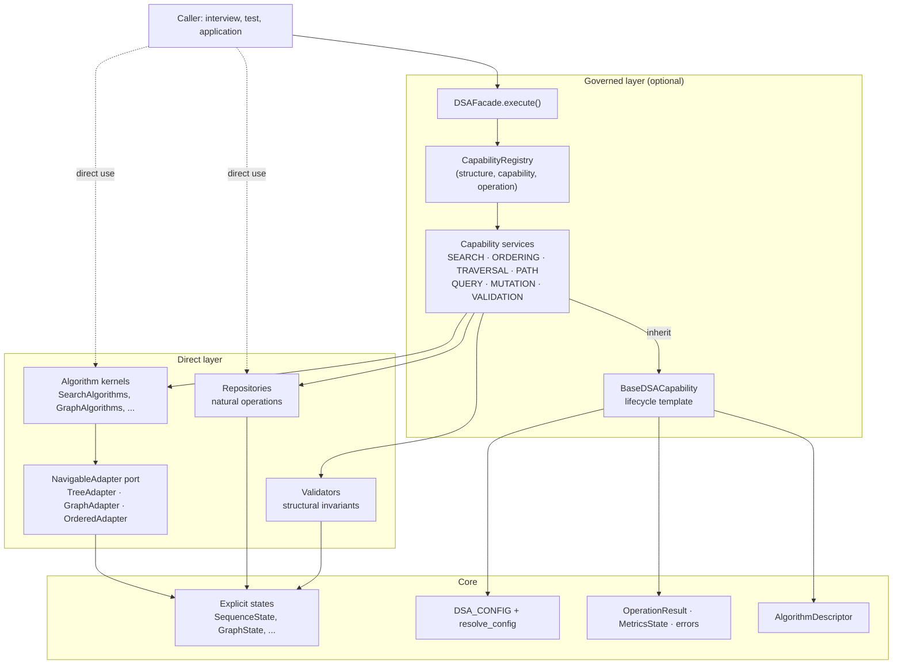
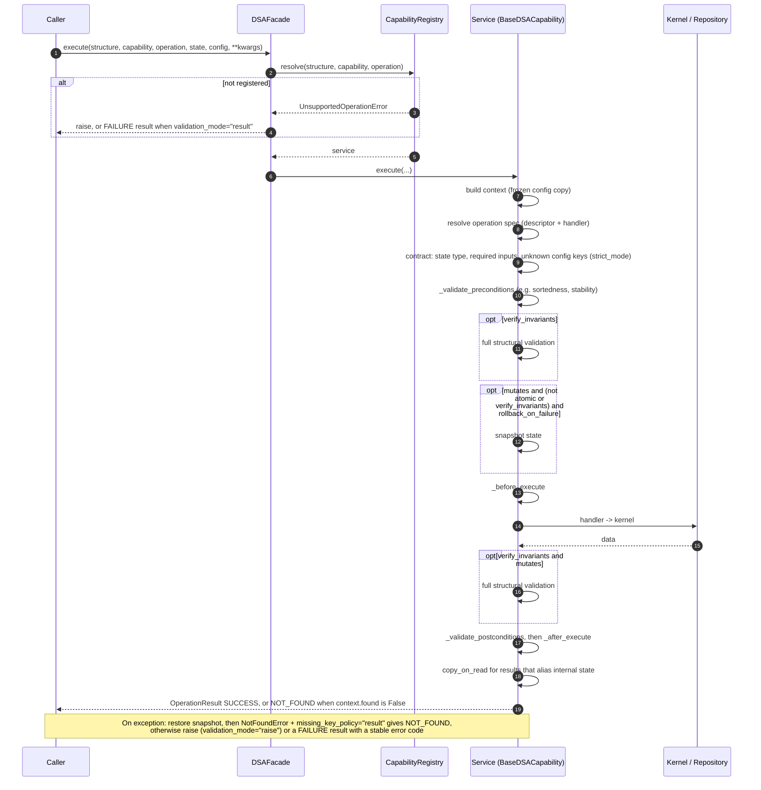

# Architecture

Capability-Oriented DSA separates five concerns that textbook implementations
usually merge: **state**, **natural operations**, **algorithms**,
**invariants** and **governance**. Each concern lives in its own layer, and
dependencies only point downwards.



| Package | Contents | May import |
|---|---|---|
| `core/` | errors, configuration, results/metrics/context, descriptors, utilities | stdlib only |
| `structures/` | state dataclasses, `NavigableAdapter` port and adapters, repositories | `core` |
| `validation/` | iterative invariant validators | `core`, `structures` |
| `algorithms/` | stateless kernels | `core`, `structures`, `validation` |
| `capabilities/` | `BaseDSACapability` and the seven services | everything above |
| `facade.py` | `CapabilityRegistry`, default wiring, `DSAFacade` | everything above |

## Two ways to use it

```python
# Direct: the textbook call, no framework overhead
SearchAlgorithms.binary([10, 20, 30, 40], 30)  # -> 2

# Governed: same kernel, plus config, contract checks, metrics, structured result
DSAFacade().execute(
    structure_type="SEQUENCE",
    capability="SEARCH",
    operation="BINARY",
    state=SequenceState([10, 20, 30, 40]),
    target=30,
)
```

Direct use is for interviews, teaching and hot paths. Governed use is for
application boundaries where you want uniform validation, configuration,
observability and error semantics.

## Operation tables instead of conditional routing

A service declares each operation with a descriptor. The base class collects
the declarations into a table keyed by `(structure_type, operation)` when the
class is defined, and `_execute_core` dispatches through it.

```python
class PathService(BaseDSACapability):
    capability = "PATH"

    @operation(
        describe(
            "DIJKSTRA",
            capability,
            "GRAPH",
            "O((V+E) log V)",
            "O(V)",
            preconditions=("all edge weights are non-negative",),
        ),
        requires=("source", "target"),
    )
    def _dijkstra(self, context, args):
        policy = self._setting(context, "dijkstra_negative_weight_policy", args)
        distance, path = GraphAlgorithms.dijkstra(
            context.state, args["source"], args["target"], negative_weight_policy=policy
        )
        context.found = bool(path)
        return distance, path
```

Consequences:

- `CapabilityRegistry.register_service(service)` registers every declared
  operation. Nothing can be routable without a descriptor, and the metadata
  registry is derived from the capability registry, so the two cannot drift.
- Required inputs are part of the declaration and checked before the kernel
  runs (`InvalidInputError`, not a `KeyError` from deep inside the kernel).
- The same operation name can map to different kernels per structure
  (`QUERY/HAS_CYCLE` for `LINKED_LIST` and `GRAPH`) without an `if`.

## Governed lifecycle



| Visibility | Members | Rule |
|---|---|---|
| Public | `execute()`, `operation_specs()` | Stable contract; do not override `execute`. |
| Protected | `_validate_preconditions`, `_before_execute`, `_execute_core`, `_validate_postconditions`, `_after_execute`, `_build_success_result`, `_build_failure_result`, `_setting`, `_metrics`, `_spec` | Extension points for subclasses. |
| Private | `__build_context`, `__resolve_operation`, `__validate_contract`, `__verify_structure`, `__snapshot` | Framework-owned invariants; name-mangled. |

## Result semantics

| Outcome | Status | `found` | Raised? |
|---|---|---|---|
| Operation succeeded | `SUCCESS` | `True` / `None` | no |
| Valid miss: search miss, unreachable path, empty traversal | `NOT_FOUND` (data still carried, e.g. insertion point, `(inf, [])`) | `False` | no |
| Referenced key missing (`NotFoundError`) | `NOT_FOUND` with `missing_key_policy="result"` (default) | `False` | only with `missing_key_policy="raise"` |
| Any other failure | `FAILURE` with `ErrorDetail.code` | `None` | yes, unless `validation_mode="result"` |

Error codes: `INVALID_INPUT`, `NOT_FOUND`, `DUPLICATE_KEY`, `INVARIANT_VIOLATION`,
`UNSUPPORTED_OPERATION`, `CAPACITY_EXCEEDED`, `PRECONDITION_FAILED`,
`INVALID_CONFIGURATION`, `EXECUTION_FAILED` (non-framework exception).

## Request-scoped identifiers

`DSAFacade.execute` (and `BaseDSACapability.execute`) accept three optional keyword
arguments that follow a request through the governed layer, using the same names
as the E2A base classes:

| Argument | What the framework does with it |
|---|---|
| `correlation_id` | Passed through unchanged to `result.metadata["propagation"]`, on success and failure alike, so a call can be tied to the larger request it belongs to. |
| `tenant_id` | Passed through like `correlation_id`, and used to namespace idempotency keys. It **isolates no data**: each call receives its own state object, so enforcement belongs to the layer that owns the data. |
| `idempotency_key` | For mutating operations only: the first successful call is applied and recorded, and a repeat with the same key and arguments returns the recorded result without touching the state (`metadata["replayed"] is True`, message `IDEMPOTENT_REPLAY`). On a read-only operation the key is only echoed. |

Rules worth knowing:

- A repeat is honoured only against the **same state object** and the **same
  arguments and config**. Anything else raises `IdempotencyConflictError`
  (`IDEMPOTENCY_CONFLICT`, a `FAILURE` result under `validation_mode="result"`).
  Callable arguments such as `key=` compare by qualified name.
- Only successful and `NOT_FOUND` outcomes are recorded. A failed first attempt
  is rolled back as usual and the same key may be retried.
- Scope is `(tenant_id, idempotency_key)`, so two tenants may reuse a key.
- Replay protects **sequential** retries. Lookup, mutation and record are not one
  atomic claim, so two simultaneous calls with the same key can both apply.
  Concurrent use needs a store, or a lock around the call, that claims the key atomically.
- The default store is in-memory, bounded by `idempotency_max_entries`, and
  process-local. A restart forgets every key, so this models the contract and is
  not durable exactly-once delivery. Pass `DSAFacade(idempotency_store=...)` with
  your own `IdempotencyStore` (`get` / `put`) to change that.
- Calling a service directly with an `idempotency_key` on a mutation requires an
  `idempotency_store=` argument; omitting it is a `ConfigurationError`, never a silent skip.
- With none of the three supplied, behaviour and results are unchanged.

## Capability matrix

| Structure | SEARCH | ORDERING | TRAVERSAL | PATH | QUERY | MUTATION | VALIDATION |
|---|---|---|---|---|---|---|---|
| `SEQUENCE` | BINARY<br>LINEAR<br>LOWER_BOUND | BUBBLE<br>MERGE<br>QUICK |  |  | MAXIMUM_SUBARRAY<br>NEXT_GREATER<br>PREFIX_SUMS<br>READ<br>SLIDING_WINDOW_MAXIMUM<br>TWO_SUM | DELETE<br>INSERT<br>UPDATE | VALIDATE |
| `LINKED_LIST` |  |  |  |  | HAS_CYCLE<br>MIDDLE | APPEND<br>DELETE<br>PREPEND<br>REVERSE | VALIDATE |
| `STACK` |  |  |  |  | PEEK | POP<br>PUSH | VALIDATE |
| `QUEUE` |  |  |  |  | PEEK | DEQUEUE<br>ENQUEUE | VALIDATE |
| `TREE` |  |  | BFS<br>DFS |  | ANCESTORS<br>DIAMETER<br>HEIGHT<br>LOWEST_COMMON_ANCESTOR | ADD_CHILD<br>ADD_ROOT<br>DELETE_SUBTREE | VALIDATE |
| `BST` | LOOKUP |  |  |  | INORDER<br>IS_AVL_BALANCED | DELETE<br>INSERT | VALIDATE |
| `TRIE` | CONTAINS<br>PREFIX |  |  |  |  | DELETE<br>INSERT | VALIDATE |
| `GRAPH` |  |  | BFS<br>DFS | ALL_SIMPLE_PATHS<br>DIJKSTRA<br>SHORTEST_UNWEIGHTED | HAS_CYCLE<br>TOPOLOGICAL_SORT | ADD_EDGE<br>ADD_VERTEX<br>REMOVE_EDGE<br>REMOVE_VERTEX | VALIDATE |

## Extending

Adding an algorithm never requires editing framework files:

1. Write the kernel as a static method (or a function) over explicit state.
2. Subclass the relevant service, or `BaseDSACapability` for a new capability,
   and declare the operation with `@operation(describe(...), requires=(...))`.
3. Register it: `registry.register_service(MyService())`, or
   `registry.register(structure, capability, operation, MyService())`.
4. If it needs a tuning knob, `register_config_key(ConfigKey(...))` instead of a constant.
5. Add tests that take the `dsa` fixture so both editions are exercised.

`examples/extend_with_astar.py` walks through this with A* search.

## Two editions, one source

`src/capability_oriented_dsa/` is the only source of truth.
`standalone/dsa_framework.py` is generated by `tools/build_standalone.py`, which
concatenates the modules in dependency order, merges imports, rejects
module-level name collisions, and appends `__all__` and `__version__`. CI runs
`--check` and the full test suite against both editions.
